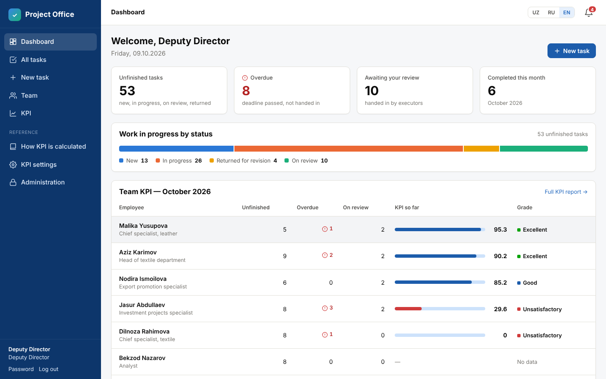
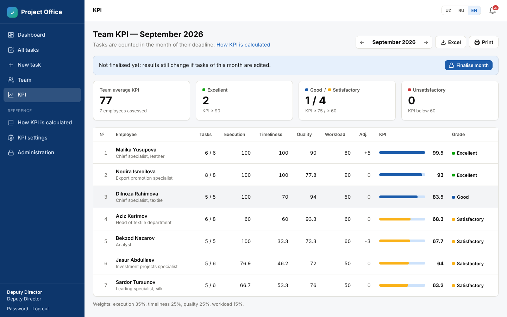
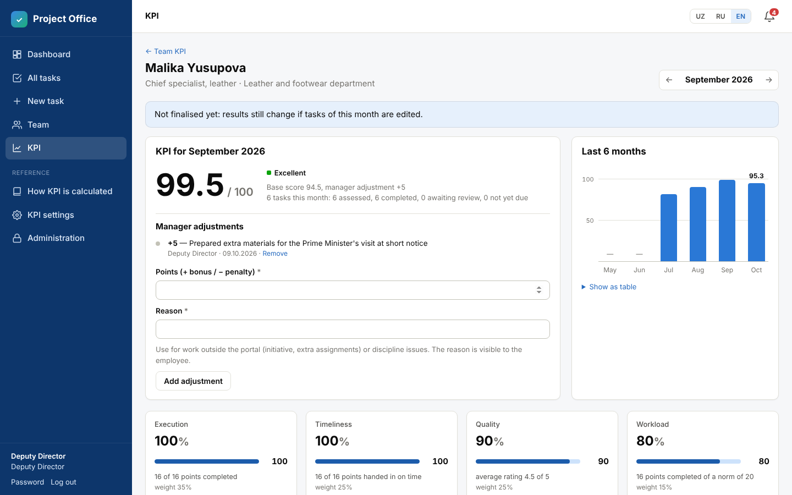
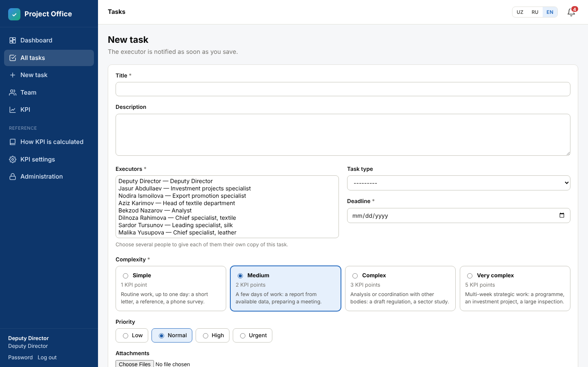
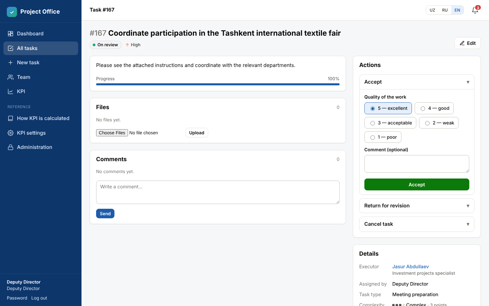
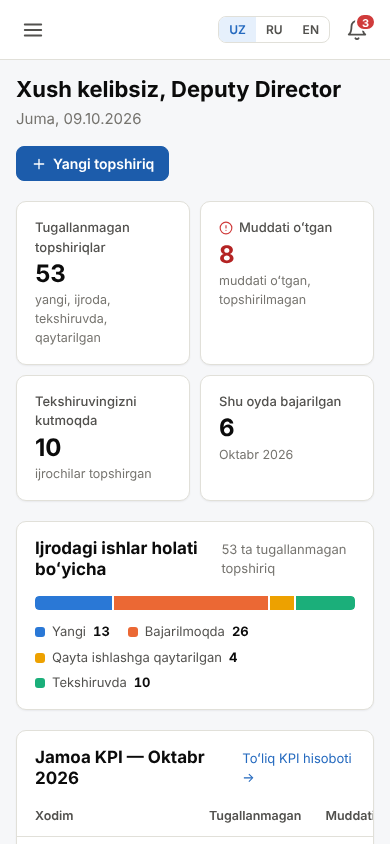

# Project Office — task & KPI portal

A web portal where a manager gives tasks of any type and complexity to the team,
follows their execution, and gets each employee's **monthly KPI** calculated
automatically.

Built for the Agency for Development of Light (Textile, Silk, Leather) Industry
under the Prime Minister of the Republic of Uzbekistan. It is self-hosted, so all
data stays on the agency's own server. Nothing is loaded from external sites.

Interface languages: **O'zbekcha (Latin) · Русский · English**. Each user switches
with one click.



## What it does

**Tasks**
- Give a task to one person, or to several people at once (each gets their own copy
  and is evaluated separately).
- Each task has a type (report, letter, draft regulation, inspection…), a
  **complexity** (Simple / Medium / Complex / Very complex), a priority, a deadline,
  a description and attached files.
- Workflow: *New → In progress → On review → Accepted*. You can also return work
  for revision with a comment, cancel a task, or reopen it.
- When you accept work, you rate its **quality from 1 to 5**.
- Comments, file uploads (checked for type and size), a progress slider and a full
  history of every change on each task.
- In-portal notifications for new tasks, submissions, returns, comments, deadline
  changes, tomorrow's deadlines and overdue tasks.

**Monitoring**
- Manager dashboard: unfinished, overdue and waiting-for-review counts, work by
  status, each employee's workload and KPI so far this month, the review queue,
  overdue tasks and the next 7 days' deadlines.
- Task list with search and filters (status, overdue, executor, department, type,
  complexity, priority, deadline range).
- Team page and personal pages with a 6-month KPI history.
- Employees see only their own tasks and their own KPI.

**KPI**
- Monthly KPI for every employee, with a breakdown anyone can check.
- Manager bonuses and penalties (±10 points by default), each with a written reason.
- **Close the month** to freeze the results. Later edits don't change history, and a
  closed month can be reopened if needed.
- Export to **Excel** (summary plus task-by-task detail) and a **printable report** with
  signature lines.
- The formula weights, complexity points, grade thresholds and workload norms are
  set on the *KPI settings* page.

| KPI report | Employee breakdown |
|---|---|
|  |  |

| New task | Reviewing a submitted task | Phone (Uzbek) |
|---|---|---|
|  |  |  |

## How the KPI is calculated

The same explanation is shown inside the portal (*How KPI is calculated*), so every
employee knows the rules.

1. **A task counts in the month its deadline falls in.** Cancelled tasks are ignored.
2. A task is **assessed** once the manager accepts it, or once its deadline passes
   without it being handed in (then it counts as not done). Tasks waiting for the
   manager's review are not counted yet, so a slow review never lowers anyone's score.
3. Each task is weighted by complexity: Simple 1, Medium 2, Complex 3, Very complex 5 points.
4. Four components, each 0–100:

| Component | Default weight | Formula |
|---|---|---|
| Execution | 35% | points of completed tasks ÷ points of assessed tasks |
| Timeliness | 25% | points handed in **by the deadline** ÷ points of assessed tasks |
| Quality | 25% | average manager rating (1–5), weighted by points, as a share of 5 |
| Workload | 15% | points completed ÷ monthly norm (default 20, can be set per person), capped at 100 |

5. **KPI = weighted sum + manager adjustments**, kept between 0 and 100.
6. Grades: **Excellent ≥ 90**, **Good ≥ 75**, **Satisfactory ≥ 60**, otherwise **Unsatisfactory**.

Timeliness uses the date the executor handed the work in, not the date it was
accepted. During the current month the workload norm is pro-rated by the days
that have passed.

*Example:* 4 tasks due (2 medium, 1 complex, 1 simple = 8 points). The complex one
was handed in a day late, the simple one was not done, and the ratings were 5, 4 and 4.
Execution 87.5, timeliness 50, quality 85.7, workload 35 → **KPI 69.8 (Satisfactory)**.
The test suite checks this example against the code.

## Try it on your computer (5 minutes)

You need Python 3.11 or newer.

```bash
python -m venv .venv
source .venv/bin/activate          # Windows: .venv\Scripts\activate
pip install -r requirements.txt
python manage.py migrate
python manage.py seed_demo         # optional: sample team and 4 months of tasks
python manage.py runserver
```

Open http://127.0.0.1:8000.

With demo data, log in as **`director`** (manager) or **`akarimov`** (employee).
The password is **`demo12345`**.

To start without demo data, create your own manager account instead:

```bash
python manage.py createsuperuser
```

## Setting it up for the team

1. Log in as the manager. On **Team**, add departments, then add each employee with
   their login, password, position, department and (optionally) personal monthly norm.
   Give a *Manager* role to anyone else who should assign and review tasks
   (for example, department heads).
2. On the same page, under **Task types**, enter the kinds of work your team does
   (analytical report, official letter, draft regulation, field inspection…).
3. Check **KPI settings** and adjust the weights and thresholds to your agency's
   rules before the first month is closed.
4. At the start of each month, open **KPI**, select the previous month, review any
   tasks still on review, then press **Close month**. Export to Excel or print.

## Production deployment (agency server)

The recommended setup is Docker with PostgreSQL:

```bash
cp .env.example .env               # then edit: secret key, server address, DB password
docker compose up -d --build
docker compose exec web python manage.py createsuperuser
```

The portal listens on port 8000. Put it behind the agency's reverse proxy (nginx or
IIS) with an HTTPS certificate, then set `DJANGO_HTTPS=1` in `.env`.

Without Docker, use the same environment variables, run
`python manage.py collectstatic`, and start
`gunicorn office.wsgi:application --bind 0.0.0.0:8000`.

**Daily reminders.** Schedule this once a day (for example 08:00) to notify people
about tomorrow's deadlines and newly overdue tasks:

```bash
docker compose exec web python manage.py send_deadline_reminders
```

**Backups.** Back up the PostgreSQL database (`pg_dump`) and the `media` volume, which
holds the attached files.

**Configuration.** All settings are environment variables, listed in `.env.example`:

| Variable | Meaning |
|---|---|
| `DJANGO_SECRET_KEY` | Long random secret (required in production) |
| `DJANGO_ALLOWED_HOSTS` | Server names / IPs users type in the browser |
| `DJANGO_HTTPS` | `1` once served over HTTPS |
| `ORGANIZATION_NAME` | Shown in the header and on printed reports |
| `DB_*` | PostgreSQL connection (`DB_ENGINE=postgres`) |
| `ATTACHMENT_MAX_SIZE_MB` | Upload limit per file (default 25) |

## For developers

```
office/     settings and URLs
accounts/   users, roles, departments, team pages
tasks/      tasks, workflow (services.py), files, comments, notifications, dashboard
kpi/        KPI formula (services.py), settings, adjustments, month closing, Excel export
templates/  HTML pages · static/css/app.css: the single stylesheet
locale/     Uzbek and Russian translations (.po source, compiled .mo)
```

- Run tests with `python manage.py test`.
- After changing interface text, run
  `python manage.py makemessages -l uz -l ru --ignore=.venv`, translate the new
  entries in `locale/*/LC_MESSAGES/django.po`, then run `python manage.py compilemessages`.
- Stack: Django 5.2 LTS (supported until April 2028), server-rendered pages, and no
  JavaScript framework.

## Possible next steps

- Telegram bot notifications (most staff already use Telegram).
- Sign-in with the agency's existing accounts (Active Directory / OneID).
- Sub-tasks and co-executors for large assignments.
- Links to official documents (decrees, resolutions) and their control numbers.
- A native-speaker review of the Uzbek and Russian wording against the agency's style.
